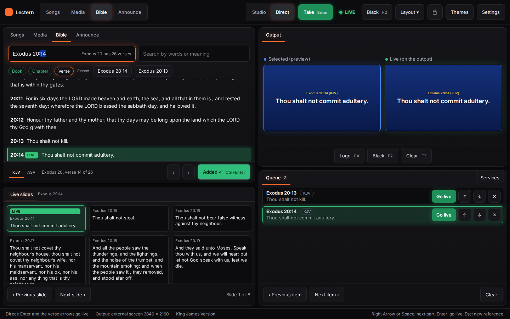
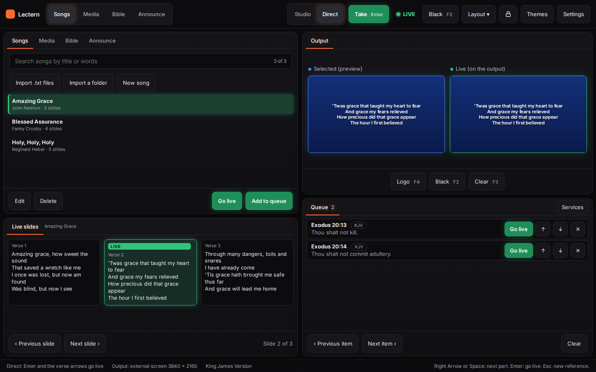

# Lectern

Free church presentation software for Windows. It shows Bible verses, song lyrics, images, videos, countdowns and announcements
on the screen or projector, and it is built to be quick to run live and hard to break.

> "Lectern" is a working name. See *Renaming* below.




*(Screenshots are from the test build with sample data.)*

## What it does
- **Bible.** Type `gen`, press Right Arrow or Space, type the chapter, again for the verse: *Genesis 1:1*. Search by words or by meaning
  ("God cared so much about humanity that he gave his only child" finds John 3:16). KJV, ASV and WEB are included; add others from your own files (XML or JSON).
- **Songs.** Import `.txt` files and the program works out the verses, chorus and order and cuts them into slides. Edit anything afterwards.
- **Media.** Images, videos, countdown timers, and backgrounds for your slides.
- **Queue.** Build the service in order. Clicking an item only *selects* it (blue). Press *Go live* to put it on screen (green).
- **Announcements.** Quick text, alerts over the current slide, and announcement slides.
- **Themes and layout.** Change how slides look. Resize the panels, lock the layout so nothing moves by accident, save your own layouts.
- **Recovery.** If the app is closed in a hurry (power cut, crash), it comes back with your queue, your place, and offers to put the last slide back on screen.
- **Updates.** The app checks GitHub and offers new versions. It never installs while something is on screen.

Selected = blue with a soft glow. Live = green with a soft glow.

## Install
1. Open the **Releases** page of this repository and download `Lectern-Setup-x.y.z.exe`.
2. Run it. Windows may say *"Windows protected your PC"* because the installer is not signed yet. Click **More info**, then **Run anyway**.
3. Plug in the projector (or HDMI splitter) and set Windows to **Extend these displays**. The output goes to the second screen by itself.

Your songs, queue, settings and media are kept in `%APPDATA%\lectern`. Updating or reinstalling does not touch them.

## Keys
| Key | Does |
|---|---|
| Right Arrow / Space | Next part of the reference (book, chapter, verse) |
| Enter | Go live |
| Up / Down | Previous / next verse (goes live) |
| PageDown / PageUp | Next / previous verse or song slide (works with a presenter clicker) |
| Ctrl+PageDown / PageUp | Next / previous chapter |
| Ctrl+Enter | Add to queue |
| Ctrl+Left / Right | Previous / next queue item (selects only) |
| `/` or Ctrl+F | Search by words |
| F2 / F3 / F4 | Black / Clear / Logo |
| Ctrl+L | Lock or unlock the layout |
| Ctrl+1 / 2 / 3 | Songs / Media / Bible |
| Ctrl+minus / plus / 0 | Smaller / bigger / normal interface size |
| Esc | Start a new reference |

## Songs
See [docs/SONG-FORMAT.md](docs/SONG-FORMAT.md). The program ships no copyrighted lyrics; each church imports its own and holds its own licences.

## Adding another Bible version
In the Bible tab, click **+ Import** next to the version tabs (bottom left). The usual Windows file window opens: choose your Bible file.
- **XML** in the common layouts: Zefania, OpenSong, OSIS, USFX (such as ebible.org downloads) and "Holy Bible XML".
- **JSON** in a few common layouts.
- A Bible with only part of the books (for example the New Testament) works too; the missing books show a message.
- Give it a short name (like NIV) and a full name, then Import. It appears as a new tab and is included in word search.
Remove an imported Bible in Settings. Only add versions you have the right to use.

## Making the screen look smaller
Settings has an **Interface size** slider (60 to 120 percent). Ctrl+minus, Ctrl+plus and Ctrl+0 do the same from the keyboard.

## For developers
```
npm install
npm start        # run the app
npm test         # logic tests and screen tests (no Windows needed)
npm run dist     # build the installer into dist/
```
Rebuilding the word-meaning file: `tools/build-thesaurus.py` (needs Python and `nltk`).

### Publishing a release
See [docs/PUBLISHING.md](docs/PUBLISHING.md).

### Renaming
The name appears in `app-info.json`, and in `package.json` (`name`, `build.productName`, `build.appId`, `build.publish.repo`).
Leave `dataFolder` in `app-info.json` alone so people keep their songs.

## Licence and credits
MIT. See [LICENSE](LICENSE) and [THIRD_PARTY_NOTICES.txt](THIRD_PARTY_NOTICES.txt).
